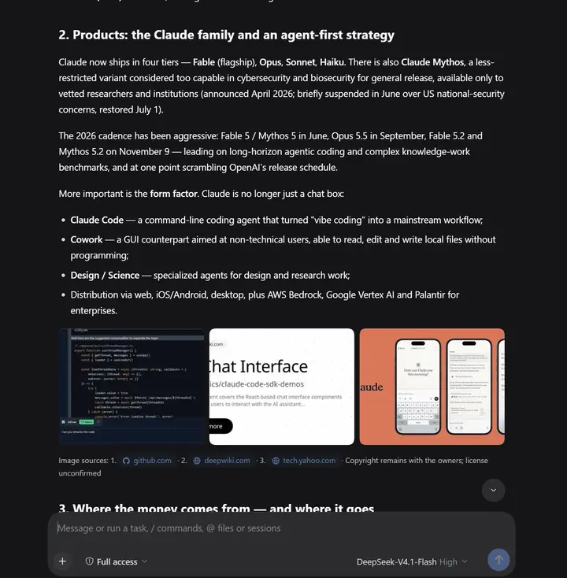
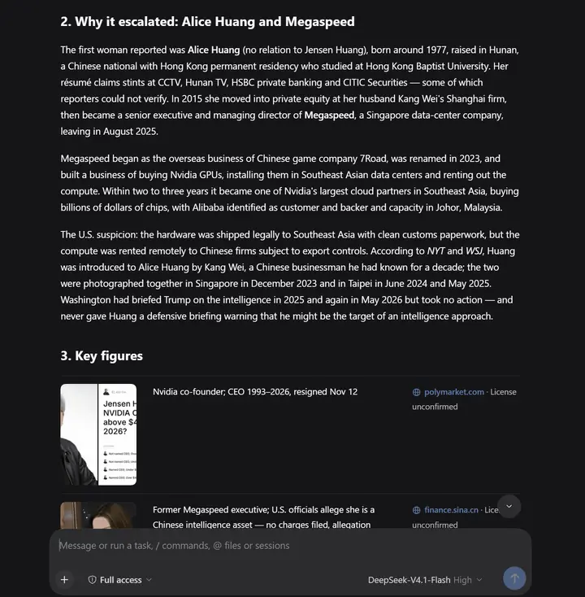

<div align="center">


# DSH Reply with Images

**Turn dense walls of AI text into magazine-grade illustrated answers in DeepSeek Harness.**

Automatically search, rank, lay out, and persist real reference images — portrait directory tables, 3-image collages, multi-angle strips, and inline cards — directly inside your DSH conversations.

[](https://github.com/TreatTrick/dsh-plugin-reply-with-images/actions/workflows/ci.yml)
[](https://www.npmjs.com/package/dsh-plugin-reply-with-images)
[](https://www.npmjs.com/package/dsh-plugin-reply-with-images)
[](https://github.com/deepseek-ai/deepseek-harness)
[](https://nodejs.org/)
[](LICENSE)

**English** | [简体中文](README.zh.md)

[Live Demos](#-see-it-in-action) · [Features](#-why-reply-with-images) · [Quick Install](#-quick-install) · [Configuration](#-configuration) · [Development](#-development--local-preview)

</div>

---

## ✨ See It in Action

Real unedited DeepSeek Harness conversations powered by `dsh-plugin-reply-with-images`:

<table>
  <tr>
    <td align="center" width="50%">
      <strong>Company & Product Deep-Dive (Anthropic)</strong><br />
      <sub>Multi-section breakdown + 3-image horizontal strip + source attribution pills</sub>
      <br /><br />
      
    </td>
    <td align="center" width="50%">
      <strong>Breaking News & Key Figures (Jensen Huang)</strong><br />
      <sub>Structured timeline + compact portrait directory cards (<code>table</code> layout)</sub>
      <br /><br />
      
    </td>
  </tr>
</table>

> **Tip:** Click either demo to view it full-size. All images are persisted through official Harness attachment storage and remain visible after restarts.

### Try These Prompts After Installing

- _"Give me a structured overview of Anthropic — founding team, Claude product lineup, and revenue trajectory."_
- _"Summarize the latest Jensen Huang / Nvidia Megaspeed story and list the key figures involved."_
- _"Explain how quantum tunneling works with real experimental setups and diagrams."_
- _"Compare the architecture and landmarks of Kyoto, Prague, and Lisbon for a 5-day trip."_

---

## 🚀 Why Reply with Images?

| Capability                     | What You Get                                                                                                                                                                                                                                        |
| ------------------------------ | --------------------------------------------------------------------------------------------------------------------------------------------------------------------------------------------------------------------------------------------------- |
| **4 Adaptive Visual Layouts**  | Plans up to 6 visual sections in a single `reply_images_prepare` call — **Portrait / Entity Directory Tables** (`table`), **3-Image Collages** (`collage`), **Multi-Angle Strips** (`strip`, up to 5 views), and **Inline Singles** (`single`).     |
| **Smart Topic Coverage**       | Automatically illustrates people, organizations, breaking news, products, places, history, nature, **plus science, physics, experiments, and diagrams** — while staying out of the way for pure code, debugging, one-liners, or text-only requests. |
| **Multi-Provider Resilience**  | Built-in fallback chain (`Bing → 360 → Baidu → Wikimedia Commons`) with zero dependency on third-party DSH search/display plugins.                                                                                                                  |
| **Signal Over Noise Ranking**  | Favors official websites, encyclopedias, and mainstream media while downranking watermarked stock galleries and SEO clutter; broken or duplicate candidates are skipped automatically.                                                              |
| **Built-in Web Client Polish** | Optional DSH Web client renders compact, responsive image rows/cards on desktop and mobile with keyboard-accessible zoom — and gracefully stays standard Markdown wherever the client isn't loaded.                                                 |
| **Durable & Authenticated**    | Saves media via official Harness attachments (`dsh-attachment`). Uses authenticated same-origin routes in Web (no tokens embedded in URLs) and native local file channels in Desktop.                                                               |

---

## 📦 Quick Install

**Requirements:** Node `>= 24.9` and a Web or Desktop DeepSeek Harness profile (`>=0.2.2-rc.3 <0.3.0`) providing the official `agents`, `tools`, `systemPrompt`, `attachments`, `connection`, and `webServer` services. _(Headless-only profiles cannot supply the display environment.)_

### Option 1: Install from npm / DSH Plugin UI (Recommended — Fastest)

Published on npm as [`dsh-plugin-reply-with-images`](https://www.npmjs.com/package/dsh-plugin-reply-with-images):

#### DSH Web / CLI

```sh
dsh plugin --profile web add dsh-plugin-reply-with-images
dsh --profile web
```

#### DSH Desktop

- **Via Plugin UI (no terminal):** Open DeepSeek Harness Desktop's sidebar plugin panel, enter `dsh-plugin-reply-with-images`, install, and restart Desktop.
- **Via bundled CLI:** Fully quit DeepSeek Harness Desktop, run:

  **Windows (PowerShell):**

  ```powershell
  & "<DSH_INSTALL_DIR>\resources\runtime\cli\bin\dsh.cmd" plugin --profile desktop add dsh-plugin-reply-with-images
  ```

  **macOS / Linux:**

  ```sh
  dsh plugin --profile desktop add dsh-plugin-reply-with-images
  ```

  Then reopen DeepSeek Harness Desktop and start a new conversation.

### Option 2: Install from GitHub Release (Offline / Direct Tarball)

```sh
dsh plugin --profile web add https://github.com/TreatTrick/dsh-plugin-reply-with-images/releases/download/v0.1.4/dsh-plugin-reply-with-images-0.1.4.tgz
```

Or download `dsh-plugin-reply-with-images-0.1.4.tgz` from [**GitHub Releases**](https://github.com/TreatTrick/dsh-plugin-reply-with-images/releases/latest) and pass the local path.

### Option 3: Build & Install from Source

```sh
git clone https://github.com/TreatTrick/dsh-plugin-reply-with-images.git
cd dsh-plugin-reply-with-images
npm ci
npm run check
npm pack
dsh plugin --profile web add ./dsh-plugin-reply-with-images-0.1.4.tgz
dsh --profile web
```

> **Linked development:** Run `npm run build` first, then `dsh plugin --profile web add .`.
>
> **Verify installation:** Run `dsh --profile web --dump-config` to confirm `reply-with-images` is registered in your profile. Replace `web` with your own Web-capable profile name if customized.

### Upgrading Notes

- Upgrading does not rewrite image URLs in older messages — open a **new conversation** to test updated behavior.
- **Release highlights:**
  - `0.1.4`: Expands automatic visual illustration to science, experiments, and diagrams; refines multi-block layout selection and package/discovery metadata.
  - `0.1.3`: Encourages mixed multi-section visual layouts (tables, collages, strips) across detailed answers.
  - `0.1.2`: Adds Wikimedia Commons licensed search and thumbnail URL support.
  - `0.1.1`: Fixes Desktop image authentication via the native file-image channel.

---

## ⚙️ Configuration

Override the plugin row in your profile's `cordis.patch.yml` (or edit via the Cordis settings panel):

```yaml
- id: reply-with-images
  config:
    providers: [bing, so360, baidu, wikimedia]
    automatic: true
    maxImagesPerTurn: 12
    maxSearchesPerTurn: 8
    maxCandidates: 10
    requestTimeoutMs: 8000
    maxImageBytes: 5242880
    maxSearchBytes: 3145728
    allowFakeIpDns: false
    publicBaseUrl: ''
    debugLog: true
    debugLogPath: ''
```

| Option               | Default                           | Description                                                                                                         |
| -------------------- | --------------------------------- | ------------------------------------------------------------------------------------------------------------------- |
| `providers`          | `[bing, so360, baidu, wikimedia]` | Ordered fallback list of image search providers (1–4 unique entries).                                               |
| `automatic`          | `true`                            | Automatically illustrate helpful answers. Set to `false` to search only when the user explicitly asks for images.   |
| `maxImagesPerTurn`   | `12`                              | Max images displayed per turn (`1–20`).                                                                             |
| `maxSearchesPerTurn` | `8`                               | Max search requests per turn (`1–16`).                                                                              |
| `maxCandidates`      | `10`                              | Max candidates returned per search (`1–20`).                                                                        |
| `requestTimeoutMs`   | `8000`                            | Per-request network timeout in milliseconds (up to `60000`).                                                        |
| `maxImageBytes`      | `5242880`                         | Max downloaded image size in bytes (5 MiB default, up to 20 MiB).                                                   |
| `maxSearchBytes`     | `3145728`                         | Max search payload size in bytes (3 MiB default, up to 10 MiB).                                                     |
| `allowFakeIpDns`     | `false`                           | Enable only for known proxy Fake-IP setups (`198.18.0.0/15` and `2001:2::/48`); all other private IPs stay blocked. |
| `publicBaseUrl`      | `''`                              | Browser-facing Harness origin (including any path prefix) for reverse-proxy Web deployments. Ignored on Desktop.    |
| `debugLog`           | `true`                            | Write bounded local JSONL diagnostics for troubleshooting image searches.                                           |
| `debugLogPath`       | `''`                              | Custom path for local JSONL diagnostics.                                                                            |

<details>
<summary><strong>Networking, Reverse Proxy &amp; Behavior Details</strong></summary>

- **Reverse proxies (Web):** Leave `publicBaseUrl` empty to use the official WebServer origin. Behind a reverse proxy, set the exact browser-facing same-origin URL (including path prefix) and forward `/api/reply-images` under that prefix to Harness with official authentication. No auth token is ever embedded in image URLs. Changing the origin/path requires migrating absolute URLs in existing answers; stored attachments remain intact.
- **Desktop:** Automatically uses provider-owned local image paths through DSH Desktop's authenticated native file-image channel, ignoring `publicBaseUrl`. Keep the local attachment store on the same host filesystem.
- **Proxy / Fake-IP DNS:** Requests use Node HTTPS and do not automatically consume `HTTP_PROXY`/`HTTPS_PROXY`. Only enable `allowFakeIpDns` when running inside a known Fake-IP proxy environment.
- **Tool architecture:** `reply_images_prepare` reserves the complete batch against remaining search and image budgets before network access. Each topic accepts `{ topic, query, alt, layout?, count? }` or `{ topic, layout?, items: [{ query, alt, caption? }] }`. Step-by-step tools `reply_image_search({ query })` and `reply_images_embed({ candidates: [{ candidateId, alt? }] })` remain supported for exact candidate selection.
- **Known limits:** Tool usage and placement depend on the model following prompt guidance. Candidate ranking relies on metadata/titles/sources rather than visual inspection. PNG/JPEG/WebP/GIF are supported and may be re-encoded by the attachment backend. Unofficial web endpoints (`bing`, `so360`, `baidu`) may throttle or return CAPTCHAs; failures fall back cleanly to text answers.
- **Attribution & Rights:** Unknown image licenses remain visibly labeled as unconfirmed without blocking in-chat reference display. Source attribution does not grant republication rights — verify image rights before public or commercial reuse.

</details>

---

## 🛠️ Development & Local Preview

```sh
npm run check          # Prettier + strict TypeScript + offline coverage tests + build + client bundle check
npm run pack:check     # Inspect tarball contents before publishing
```

### Local Previews

- **Illustrated answer preview:** Run `npm run preview:generate` (optionally with `-- --allow-fake-ip-dns`) and open `preview.html` to see a self-contained illustrated reply generated from live queries.
- **Web client layout preview:** Run `npm run preview:client` and open `client-preview.html` to inspect portrait directory cards, 3-image collages, horizontal strips, comparison tables, dark/light themes, and keyboard zoom.

CI validates Node 24 across **Windows, Linux, and macOS**. See [CONTRIBUTING.md](CONTRIBUTING.md) for module responsibilities, testing rules, and coverage standards.

---

## 📄 Disclaimer & License

- Built against the official DeepSeek Harness [bundle installation](https://github.com/deepseek-ai/deepseek-harness/blob/master/docs/user/develop/basic/publish.md), [tool authoring](https://github.com/deepseek-ai/deepseek-harness/blob/master/docs/cookbook/adding-a-tool.md), and [attachment](https://github.com/deepseek-ai/deepseek-harness/blob/master/docs/subsystems/attachment.md) guides.
- This is an independent community plugin, unaffiliated with DeepSeek or OpenAI, and does not install into ChatGPT.
- Code is licensed under the [MIT License](LICENSE). Third-party images retrieved during chat remain the property of their respective copyright holders.

---

<div align="center">

**Enjoying richer, more readable answers in DeepSeek Harness?**  
Consider giving this repository a ⭐ — it helps more DSH users discover the plugin!

</div>
