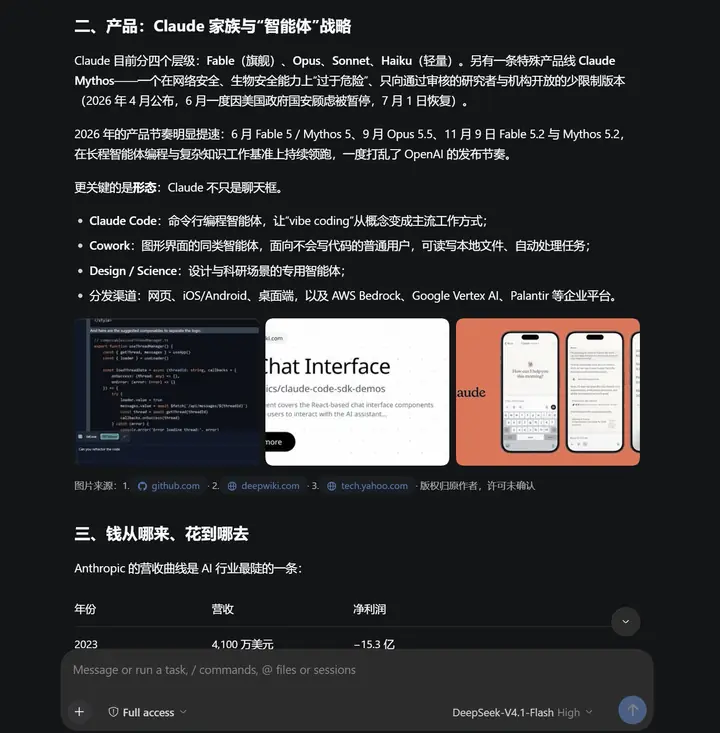
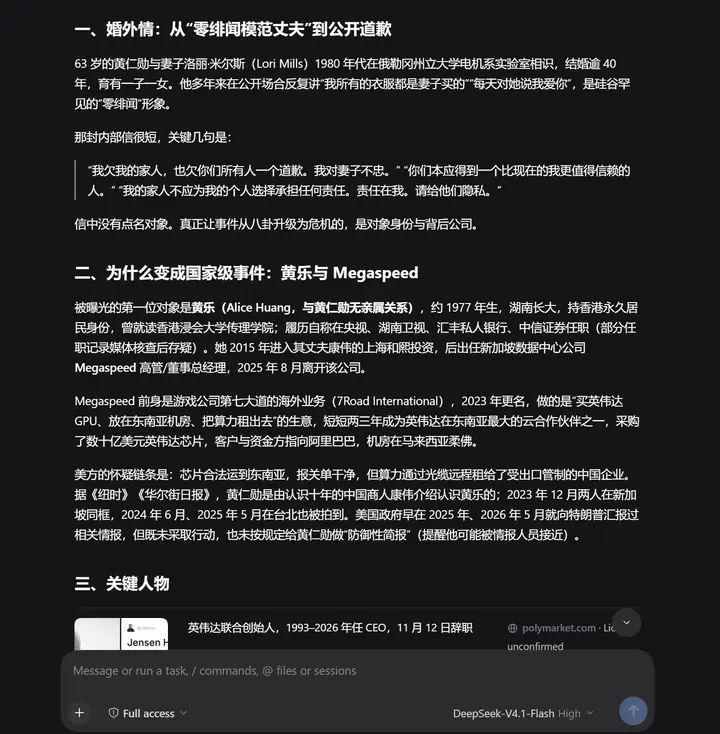

<div align="center">


# DSH 回答配图（Reply with Images）

**告别枯燥的纯文字刷屏——为 DeepSeek Harness 的回答自动配图，一键拥有杂志级图文阅读体验。**

自动搜索、优选排序、智能排版并持久化保存真实参考图片：人物目录卡片、三图拼贴、多角度横向图集与正文单图，全部原生融入你的 DSH 对话。

[](https://github.com/TreatTrick/dsh-plugin-reply-with-images/actions/workflows/ci.yml)
[](https://www.npmjs.com/package/dsh-plugin-reply-with-images)
[](https://www.npmjs.com/package/dsh-plugin-reply-with-images)
[](https://github.com/deepseek-ai/deepseek-harness)
[](https://nodejs.org/)
[](LICENSE)

[English](README.md) | **简体中文**

[实拍动图演示](#-实拍效果演示) · [核心亮点](#-核心亮点) · [快速安装](#-快速安装) · [配置说明](#-配置说明) · [本地开发与预览](#-本地开发与预览)

</div>

---

## ✨ 实拍效果演示

以下均为 DeepSeek Harness 真实对话录屏（未经后期拼接），展示了不同内容场景下的自动搜图与混合排版效果：

<table>
  <tr>
    <td align="center" width="50%">
      <strong>公司与产品深度介绍（Anthropic）</strong><br />
      <sub>多章节长文结构 + 三图横向图集 + 轻量来源胶囊标注</sub>
      <br /><br />
      
    </td>
    <td align="center" width="50%">
      <strong>热点新闻与关键人物梳理（黄仁勋事件）</strong><br />
      <sub>事件脉络拆解 + 紧凑型人物头像目录卡片（<code>table</code> 布局）</sub>
      <br /><br />
      
    </td>
  </tr>
</table>

> **提示：** 点击上方任意动图可放大查看高清细节。所有配图都会写入 DSH 官方附件存储，重启后依然正常显示。

### 装完立刻试试这些提问

- _“全面介绍一下 Anthropic：创始团队、Claude 产品线，以及营收与融资情况。”_
- _“梳理一下黄仁勋 / Megaspeed 事件的来龙去脉，并列出关键人物。”_
- _“用实验装置和示意图讲清楚量子隧穿效应是怎么回事。”_
- _“对比京都、布拉格和里斯本三座城市的代表性建筑与地标，帮我做 5 天旅行参考。”_

---

## 🚀 核心亮点

| 特性                    | 体验提升                                                                                                                                                                              |
| ----------------------- | ------------------------------------------------------------------------------------------------------------------------------------------------------------------------------------- |
| **四种智能图文布局**    | 单次 `reply_images_prepare` 调用即可规划最多 6 个图文区块：**人物/实体目录卡片**（`table`）、**三图拼贴**（`collage`）、**最多五图横向图集**（`strip`）与**正文单图**（`single`）。   |
| **场景覆盖广，懂克制**  | 涵盖公众人物、企业产品、热点新闻、地理风光、历史自然，以及 **科学原理、实验现象与示意图**（`0.1.4` 增强）；纯代码调试、纯符号推导、一句话短答或明确要求纯文字时自动跳过，不打扰阅读。 |
| **多图源自动兜底**      | 内置 `Bing → 360 → 百度 → Wikimedia Commons` 多引擎回退链，**零第三方 DSH 搜图/展示插件依赖**，开箱即用。                                                                             |
| **高信噪比排序**        | 优先相关官网、百科与主流媒体，自动对水印图库和非请求的 SEO 八卦降权；候选下载失败或内容重复时自动顺延补位。                                                                           |
| **内置 Web 端视觉增强** | 可选 Web 客户端为含图表格提供桌面/移动端自适应紧凑排版、轻量来源胶囊与键盘可访问放大预览；未启用客户端时无缝退化为标准 Markdown 图片。                                                |
| **持久化与安全隔离**    | 通过 DSH 官方附件系统保存图片，Web 端走同源鉴权路由（URL 不暴露 Token），Desktop 端走原生本地文件通道；内置 SSRF/DNS 校验、体积与超时上限。                                           |

---

## 📦 快速安装

**环境要求：** Node `>= 24.9`，以及包含官方 `agents`、`tools`、`systemPrompt`、`attachments`、`connection`、`webServer` 服务的 DSH Web 或 Desktop profile（适配 `>=0.2.2-rc.3 <0.3.0`）。_（纯无头模式不支持页面图片展示。）_

### 方式一：通过 npm / DSH 插件界面一键安装（推荐，最快上手）

已正式发布至 npm：[`dsh-plugin-reply-with-images`](https://www.npmjs.com/package/dsh-plugin-reply-with-images)

#### DSH Web / 命令行

```sh
dsh plugin --profile web add dsh-plugin-reply-with-images
dsh --profile web
```

#### DSH Desktop（桌面端）

- **侧边栏插件界面直接装（零命令行）：** 打开 DeepSeek Harness Desktop 侧边栏插件管理，输入包名 `dsh-plugin-reply-with-images` 安装并重启即可。
- **使用自带命令行安装：** 先**完全退出** DeepSeek Harness Desktop，再运行：

  **Windows（PowerShell）：**

  ```powershell
  & "<DSH安装目录>\resources\runtime\cli\bin\dsh.cmd" plugin --profile desktop add dsh-plugin-reply-with-images
  ```

  **macOS / Linux：**

  ```sh
  dsh plugin --profile desktop add dsh-plugin-reply-with-images
  ```

  然后重新启动 DeepSeek Harness Desktop，新建对话即可体验。

### 方式二：通过 GitHub Release 离线 / 直链安装

```sh
dsh plugin --profile web add https://github.com/TreatTrick/dsh-plugin-reply-with-images/releases/download/v0.1.4/dsh-plugin-reply-with-images-0.1.4.tgz
```

也可先从 [**GitHub Releases**](https://github.com/TreatTrick/dsh-plugin-reply-with-images/releases/latest) 手动下载 `dsh-plugin-reply-with-images-0.1.4.tgz`，再传入本地路径。

### 方式三：从源码构建并安装

```sh
git clone https://github.com/TreatTrick/dsh-plugin-reply-with-images.git
cd dsh-plugin-reply-with-images
npm ci
npm run check
npm pack
dsh plugin --profile web add ./dsh-plugin-reply-with-images-0.1.4.tgz
dsh --profile web
```

> **本地联调开发：** 先运行 `npm run build`，再执行 `dsh plugin --profile web add .`。
>
> **安装自检：** 执行 `dsh --profile web --dump-config` 确认 `reply-with-images` 已出现在配置中（如有自定义 profile 名称，请替换 `web`）。

### 升级说明与更新亮点

- 升级插件不会改写历史对话里已生成的图片链接，请通过**新对话**验证新版本效果。
- **版本演进：**
  - `0.1.4`：扩展科学概念、实验现象与示意图场景的自动配图引导，优化多区块图文组合策略与插件元数据。
  - `0.1.3`：面向多章节长回答引入混合配图布局（表格 / 拼贴 / 图集）。
  - `0.1.2`：支持 Wikimedia Commons 许可图源与缩略图解析。
  - `0.1.1`：修复 Desktop 桌面端原生文件通道图片鉴权问题。

---

## ⚙️ 配置说明

可在对应 profile 的 `cordis.patch.yml` 中覆盖配置（或在 Cordis 配置面板直接调整）：

```yaml
- id: reply-with-images
  config:
    providers: [bing, so360, baidu, wikimedia]
    automatic: true
    maxImagesPerTurn: 12
    maxSearchesPerTurn: 8
    maxCandidates: 10
    requestTimeoutMs: 8000
    maxImageBytes: 5242880
    maxSearchBytes: 3145728
    allowFakeIpDns: false
    publicBaseUrl: ''
    debugLog: true
    debugLogPath: ''
```

| 配置项               | 默认值                            | 说明                                                                                                   |
| -------------------- | --------------------------------- | ------------------------------------------------------------------------------------------------------ |
| `providers`          | `[bing, so360, baidu, wikimedia]` | 按顺序执行的图源列表（1–4 个，不可重复）。                                                             |
| `automatic`          | `true`                            | 是否自动配图；设为 `false` 时仅在用户明确要求配图时搜索。                                              |
| `maxImagesPerTurn`   | `12`                              | 单轮回答最多展示的图片数（`1–20`）。                                                                   |
| `maxSearchesPerTurn` | `8`                               | 单轮回答最多发起的搜索次数（`1–16`）。                                                                 |
| `maxCandidates`      | `10`                              | 每次搜索最多返回的候选图数（`1–20`）。                                                                 |
| `requestTimeoutMs`   | `8000`                            | 单次网络请求超时时间（毫秒，最高 `60000`）。                                                           |
| `maxImageBytes`      | `5242880`                         | 单张下载图片体积上限（默认 5 MiB，最高 20 MiB）。                                                      |
| `maxSearchBytes`     | `3145728`                         | 单次搜索响应体上限（默认 3 MiB，最高 10 MiB）。                                                        |
| `allowFakeIpDns`     | `false`                           | 仅在明确的代理 Fake-IP 环境下开启（额外放行 `198.18.0.0/15` 与 `2001:2::/48`），其余内网地址依然拦截。 |
| `publicBaseUrl`      | `''`                              | Web 反向代理部署时的浏览器访问根地址（含路径前缀）；Desktop 端自动忽略。                               |
| `debugLog`           | `true`                            | 是否记录本地 JSONL 搜图诊断日志。                                                                      |
| `debugLogPath`       | `''`                              | 自定义本地诊断日志输出路径。                                                                           |

<details>
<summary><strong>代理网络、反向代理与使用边界说明</strong></summary>

- **Web 反向代理：** 常规本地使用保持 `publicBaseUrl` 为空即可。若部署在反代之后，请填入浏览器实际访问的同源根 URL（含前缀路径），并将该前缀下的 `/api/reply-images` 转发到 Harness 且保留官方鉴权。图片 URL 不含任何鉴权 Token。
- **代理与 Fake-IP：** 插件网络请求走 Node HTTPS，不会自动读取 `HTTP_PROXY`/`HTTPS_PROXY` 环境变量；仅在已知 Fake-IP 代理环境中开启 `allowFakeIpDns`。
- **工具机制：** 除了主力批量工具 `reply_images_prepare`，还完整兼容分步工具 `reply_image_search` 与 `reply_images_embed`，便于精确挑选单张候选图。
- **能力边界：** 是否调用工具及排版位置取决于模型对提示词的遵循程度；图片优选基于标题、来源与元数据而非视觉内容识别。非官方搜索引擎接口（Bing / 360 / 百度）可能偶发限流或验证码，失败时会平滑降级为纯文字回答。
- **来源与版权：** 许可未确认的参考图会如实标注来源与“许可未确认”，不妨碍会话内参考展示；但来源标注不构成再发布授权，公开或商业使用前请自行核实图片版权。

</details>

---

## 🛠️ 本地开发与预览

```sh
npm run check          # 代码格式检查 + 严格 TS 类型检查 + 离线测试覆盖率 + 构建 + 客户端产物校验
npm run pack:check     # 预检 npm pack 打包清单
```

- **真实搜图回答预览：** 运行 `npm run preview:generate`（Fake-IP 环境可加 `-- --allow-fake-ip-dns`），打开生成的 `preview.html`。
- **Web 客户端排版预览：** 运行 `npm run preview:client`，打开 `client-preview.html`，可直观检查人物目录卡片、三图拼贴、横向图集、多图对比、亮暗主题切换与键盘缩放交互。

CI 在 **Windows、Linux、macOS** 上基于 Node 24 持续验证。贡献规范与测试要求详见 [CONTRIBUTING.md](CONTRIBUTING.md)（完整英文文档见 [README.md](README.md)）。

---

## 📄 声明与开源协议

- 本插件为独立社区开源项目，遵循 DeepSeek Harness 官方插件、工具与附件规范开发，与 DeepSeek 或 OpenAI 无官方隶属关系，也不支持安装到 ChatGPT。
- 插件代码基于 [MIT License](LICENSE) 开源；对话中检索并展示的第三方图片版权归原作者及原站点所有。

---

<div align="center">

**如果这个插件让你的 DeepSeek Harness 对话阅读体验上了一个台阶，**  
欢迎点一颗 ⭐ **Star** 支持一下，也方便更多 DSH 用户搜到它！

</div>
